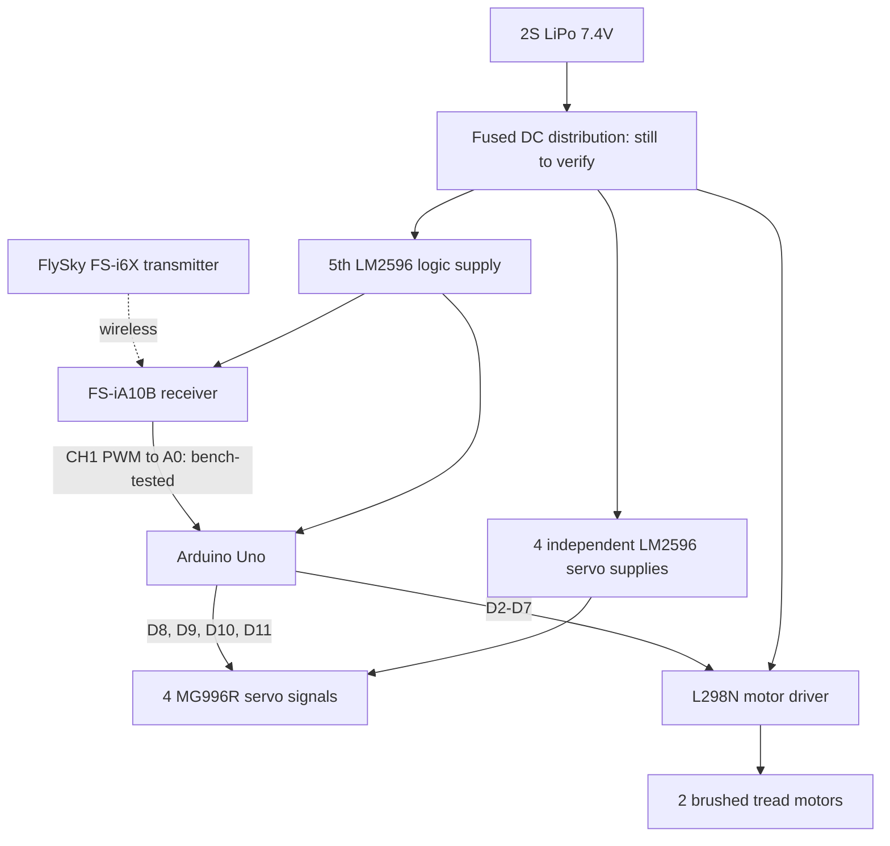

# SAD — Smol Arm Dynamics | Mobile Robotic Arm

> **Status:** Active student-built robotics prototype • Updated 2026-11-25  
> **Repository visibility:** Private while the team reviews the work.

## Mission

Build a remote-controlled, programmable robotic arm mounted on a two-tread mobile chassis, and document the electrical, mechanical and embedded-software development from first tests to integrated demonstrations.

**Not a finished robot or commercially available product.** This repository is the engineering source of truth, separate from the SAD website.

## Architecture

| Subsystem | Hardware | Status |
|---|---|---|
| Controller | Arduino Uno R3 | Working for bench test |
| Radio | FlySky FS-i6X and FS-iA10B | Six receiver PWM channels previously tested |
| Arm | 4 × MG996R servos (1 spare) | Servo 1 wirelessly controlled, 3 pending |
| Drive | Two yellow brushed DC gear motors, two tracks, L298N | Not integrated; motor ratings unverified |
| Power | 7.4V 2000mAh 2S LiPo (25C), 5 × LM2596 | Final power system unverified |

### Verified breakthrough — November 25, 2026

FlySky receiver **CH1 PWM → Arduino A0 → Servo 1 signal D8** successfully moved the MG996R approximately **60–120°**. The Arduino was initially displaying correct commands but the servo stayed stationary; connecting the converter's **OUT− to Arduino GND** established the missing common signal reference and solved it.

The tested sketch currently uses **absolute position** (stick springs to center → servo returns toward 90°). The team has decided that the finished arm should use **incremental control (Option B)** (stick deflection causes motion; released stick holds its last commanded position). That feature has **not** yet been tested.

## Electrical overview

This is a **system-level architecture diagram, not a fully validated wiring schematic**. All grounds must share a reference, **never combine separate regulator positive outputs**, and never run servo/motor power through an Arduino 5V pin or breadboard.

## Start here

- [Hardware inventory](docs/hardware-inventory.md)
- [Verified test and planned pin map](docs/wiring-and-pinout.md)
- [System architecture](docs/system-architecture.md)
- [First working servo engineering log](docs/build-logs/2026-11-25-first-wireless-servo.md)
- [Safety checklist](docs/safety-checklist.md)
- [Build and test roadmap](docs/roadmap.md)
- [Firmware: tested vs draft](firmware/README.md)
- [Open technical questions](docs/open-questions.md)
- [Team contribution guide](CONTRIBUTING.md)
- [GitHub Issues backlog](../../issues)

## Team workflow

After each build session: save a dated log (goal, exact wiring and code, measurement, result, troubleshooting and next test); commit the **actual verified** firmware; update test evidence and relevant issues. Do not claim a milestone is tested without physical verification. Ask teammates before publishing their names, photos, or the repository.

## Critical safety notes

Use an appropriately fused and insulated battery distribution with correctly rated connectors and wire. Do not short LiPo output or use its JST balance plug for motor power. Measure buck voltages before connecting electronics; check voltage **under load** as well. Verify motor voltage/current and L298N jumpers before powering drive motors. A 2S LiPo may drop below the LM2596's needed voltage headroom. Arrange Arduino external 5V/USB isolation before integrating the fifth regulator.
