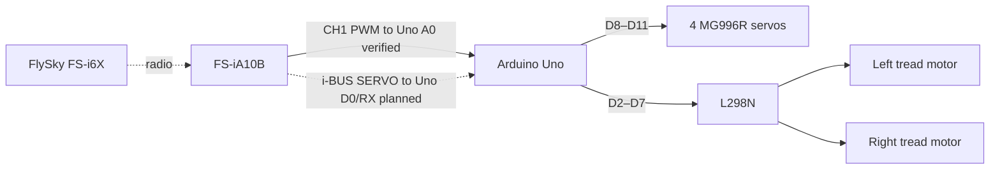
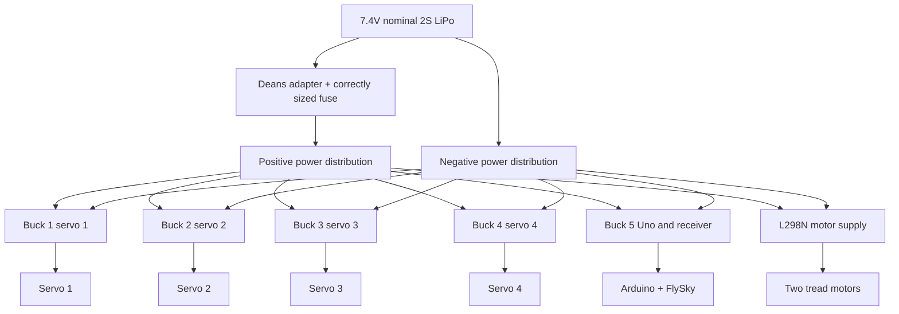

# System architecture

## Control path

## Power path

**Architecture illustration only**, not verified connection-by-connection. Each servo receives both OUT+ and OUT− from its respective buck and a separate signal from Uno. All signal grounds share the battery-negative reference. Regulated positive outputs are not paralleled.

## Operating modes (future)
- **Drive:** differential motion of two treads, arm maintains its commanded positions.
- **Arm:** motors disabled, joystick deflection commands incremental joint motion; centered stick holds last position.
- **Safety:** radio-signal-loss motor stop, motor disable when switching modes, travel limits, LiPo undervoltage protection.
