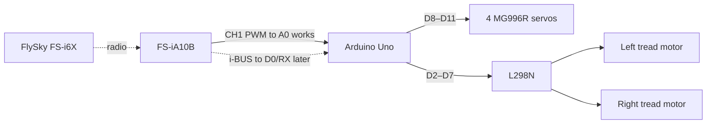
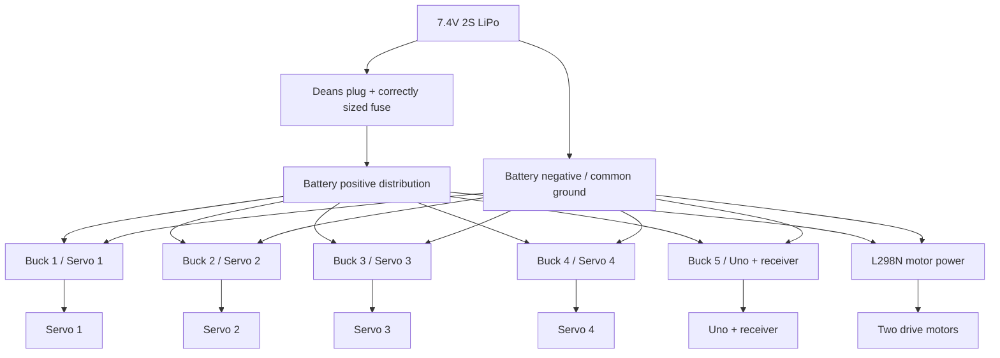

# How everything connects

This is the rough system layout, **not a final wiring diagram we can safely power up without checking**.

## Signals

## Power

Each servo gets both + and − from **its own** buck, and the signal comes from the Uno. The Arduino needs a common ground with the bucks. Don't combine different bucks' positive outputs.

The plan is to have **drive mode** for the treads and **arm mode** for the four servos. In arm mode we want the joystick to move a joint and leave it where it is when released. That's still to be coded and tested. The finished code also needs to stop the drive motors if we lose radio contact.
